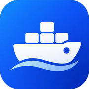
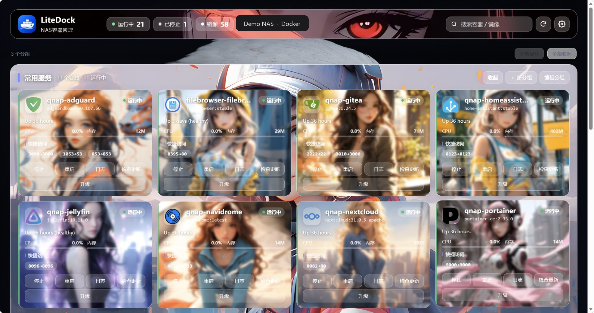
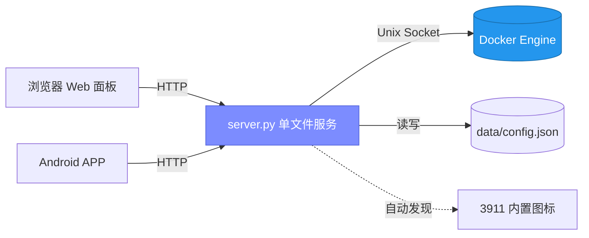

<p align="center">
  
</p>

<h1 align="center">LiteDock</h1>

<p align="center">为 NAS 而生的轻量 Docker 容器面板 —— Web 与 Android 双端同源，一个 Python 文件直连 Docker Socket。</p>

<p align="center"><sub>作者 <b>Stark-C</b> · 个人项目 · 持续维护中</sub></p>

<p align="center">
  <a href="#快速开始">快速开始</a> ·
  <a href="#界面预览">预览</a> ·
  <a href="#为什么是-litedock">特性</a> ·
  <a href="#和同类工具的定位差异">对比</a> ·
  <a href="#安全须知">安全须知</a> ·
  <a href="#许可">许可</a>
</p>

<p align="center">
  <a href="LICENSE"></a>
  
  
  
  
</p>

---

## 界面预览

| 主界面与容器状态 | 分组与 Compose 项目 |
|---|---|
| [](docs/images/dashboard.jpg) | [](docs/images/groups.jpg) |

| 壁纸与外观设置 | 关于与运行环境 |
|---|---|
| [](docs/images/appearance.jpg) | [](docs/images/about.jpg) |

> 截图中的容器、分组与自定义壁纸仅作界面演示；实际内容与默认样式以你的部署配置为准。

## 为什么是 LiteDock

不追功能堆砌，只把日常容器管理做得**轻、快、好看**。

- **一个文件就是服务端**：`server.py` 只用 Python 标准库直连 `/var/run/docker.sock`，没有 npm、没有数据库、没有 agent，镜像不到 90 MB。
- **Web 与 Android 双端同源**：一套业务逻辑，两种入口。APP 不是缩水网页，而是用 Capacitor 壳打包的原生应用，界面与 Web 保持同一套设计语言。
- **Compose 项目是一等公民**：多容器自动合并成一张卡，按 `depends_on` 拓扑排序批量启停，镜像升级自动备份旧容器并支持双向回滚。
- **看得懂的状态**：CPU / 内存占用条、启动时间、healthy 标记、有新镜像提示，异常容器一眼可见。
- **内外网双栈快捷访问**：自定义内网链接与外网反代链接分别配置，端口自动推导、IPv4 优先去重、HTTPS 端口自动识别。
- **NAS 视觉管理**：壁纸、玻璃拟态卡片、分组强调色、单卡背景、紧凑模式，容器面板也可以是好看的。
- **内置 3911 个应用图标**：来自 [homarr-labs/dashboard-icons](https://github.com/homarr-labs/dashboard-icons)（MIT），按容器名与镜像名自动匹配。
- **面板会保护自己**：识别运行自身的容器，禁止从界面停止 / 重启 / 升级自己，避免把自己关在门外。
- **日志不用来回点**：Web 日志弹窗与 APP 详情页每 5 秒自动刷新，可随时暂停。
- **APP 能自己更新**：在「关于 → APP 更新」检查新版，下载后用 Release 提供的 SHA-256 校验值核对，再交给系统安装器，不替你静默装包。

### 工作原理



一台 NAS 部署一个实例，浏览器和手机 APP 连同一个地址即可，配置集中保存在挂载目录的 `config.json`。

### 和同类工具的定位差异

| | LiteDock | Dockge | Portainer |
|---|---|---|---|
| 定位 | NAS 上的轻量日常面板 | Compose 文件管理 | 多环境容器平台 |
| 依赖 | Python 标准库，零数据库 | Node 栈 | Go 多服务 |
| Compose 文件编辑 | 不需要（管理已有容器） | 核心能力 | 支持 |
| 原生手机 APP | 有 | 无 | 无 |
| 多主机 / K8s / RBAC | 不支持（有意不做） | 不支持 | 支持 |
| 适合 | 一台或多台 NAS，日常看状态、启停、升级 | 以 Compose YAML 为工作流 | 多机、多租户、编排 |

---

## 快速开始

### 1. 部署

在任意支持 Docker Compose 的 NAS（或普通 Linux 主机）上部署。新建 `docker-compose.yml`，粘贴以下内容后执行 `docker compose up -d`：

```yaml
services:
  litedock:
    # Docker Hub 镜像（开箱即用）；本地从源码构建可 build 成同名 tag 后自行 push
    image: stark324/litedock:1.0.31
    container_name: litedock
    ports:
      - "23000:8000"
    environment:
      - ACCESS_PASSWORD=change-me   # 必填：留空服务端将拒绝启动（docker.sock≈root，禁止裸奔）
      - LITEDOCK_PUBLIC_HOST=     # 可选：填 NAS 的局域网 IP，启动日志会打印完整访问地址
      - LITEDOCK_SELF_NAME=litedock
    volumes:
      - ./data:/app/data                 # 换成一个你自己的本地目录
      - /var/run/docker.sock:/var/run/docker.sock
    # 以 root 运行便于读 docker.sock、写挂载目录；若你的 NAS 用非 root 用户管理 Docker，
    # 可改成对应用户，或加入 docker 组后去掉本行（需保证 /app/data 可写、docker.sock 可读）。
    user: "0:0"
    restart: unless-stopped
```

其中 `./data` 换成你希望保存配置的目录（各 NAS 的数据盘路径不同，按实际填写）。访问 `http://<你的NAS地址>:23000`。

> 每台 NAS 各部署一个 LiteDock 实例，即可用同一个 Web 页面或多台设备上的 APP 分别管理；APP 的「连接管理」支持保存多个地址，随时切换。

### 2. 安卓 APP

当前安卓版本：**1.0.26**（[下载 APK](https://github.com/chqmoon/LiteDock/releases/download/app-v1.0.26/LiteDock-App-1.0.26.apk) · [全部版本](https://github.com/chqmoon/LiteDock/releases)）。侧载安装后，打开 APP 在「连接管理」里填 Web 面板的地址；若服务端设置了 `ACCESS_PASSWORD`，在连接里填同一个密码即可。

APP 内「关于 → APP 更新」可检查新版本：发现新版后点「下载并安装」，APK 从 GitHub Releases 下载并用该 Release 提供的 SHA-256 摘要核对，确认一致才交给系统安装器。启动时也会每天在后台检查一次，只在关于页显示提示，不弹窗打扰。

### 3. 配置

所有外观与行为配置都在 Web 面板「设置」里完成：标题 / 副标题、壁纸与模糊、卡片圆角与透明度、分组方式、容器分组、图标替换、快捷访问链接、列数与紧凑模式。配置保存在挂载目录的 `data/config.json`。

### 4. 常见问题

<details>
<summary><b>怎么更新到新版本？</b></summary>

修改 `docker-compose.yml` 里的镜像 tag（如 `stark324/litedock:1.0.31` → 新版号），然后执行：

```bash
docker compose pull && docker compose up -d
```

配置与壁纸保存在挂载的 `./data`，更新容器不会丢。

APP 的更新在「关于 → APP 更新」里完成，会下载新 APK 并校验摘要；首次侧载安装时，系统可能要求确认「允许安装未知来源应用」，按提示授权即可。

</details>

<details>
<summary><b>升级面板自己怎么办？</b></summary>

面板会禁止从界面停止 / 重启 / 升级自身容器（防止把自己关在门外）。升级本体只能用上面的方式改镜像 tag 重新部署。

</details>

<details>
<summary><b>升级普通容器安全吗？</b></summary>

点卡片「升级」时，旧容器会自动改名备份并在面板中隐藏；升级后可在「设置 → 升级备份」里一键回退或删除备份释放空间。

</details>

<details>
<summary><b>配置怎么备份 / 迁移？</b></summary>

复制挂载目录里的 `data/config.json`（以及 `data/uploads/` 内的壁纸、图标、卡片背景）即可，到新 NAS 上放回同一目录就能恢复。

</details>

<details>
<summary><b>图标显示不全 / 有留白？</b></summary>

内置图标按容器名自动匹配，保留原始比例；如果上传的自定义图标想铺满整个图标位，在「设置 → 图标」绑定到容器后会以铺满方式显示。

</details>

<details>
<summary><b>能否用一套面板管理多台 NAS？</b></summary>

每台 NAS 各部署一个 LiteDock 实例。Web 面板分别访问各自地址；APP 的「连接管理」可保存多个地址，随时切换。LiteDock 只读取当前所在宿主机的 Docker，不跨主机。

</details>

<details>
<summary><b>APP 连不上面板怎么排查？</b></summary>

确认手机与 NAS 在同一网络、地址端口正确（默认 23000）；若服务端设了 `ACCESS_PASSWORD`，连接里要填相同密码。安卓侧载安装需在系统设置里允许「安装未知来源应用」。

</details>

---

## 安全须知

> ⚠️ **挂载 `docker.sock` 等价于把宿主机 root 交给容器。LiteDock 的安全底线 = 强密码 + 可信网络，部署前请务必读完本节。**

### 内置防线

| 防线 | 说明 |
|---|---|
| **强制密码** | `ACCESS_PASSWORD` 留空时服务端**拒绝启动**，从源头杜绝裸奔。所有 `/api/*`（除健康检查）都校验 `X-LiteDock-Token` 头。仅限隔离的本机调试可设 `LITEDOCK_ALLOW_NOAUTH=1` 绕过（**不要在公网 / 共享网络这么做**） |
| **恒定时间比对** | 密码用 `hmac.compare_digest` 比对，防时序侧信道，并支持中文密码 |
| **登录限速** | 连续 5 次密码错误锁定 30 秒（进程内计数，重启清零） |
| **路径穿越防护** | 上传 / 图标读写走 `commonpath` 越界校验，越界一律 403 |
| **上传防护** | 上传上限 30 MB；上传目录 `nosniff` + SVG 单独 CSP 禁脚本 |
| **自我保护** | 识别自身容器，拒绝停止 / 重启 / 暂停 / 升级自己（升级本体请按 FAQ 改镜像 tag 重新部署） |
| **健康探针例外** | `/api/health` 有意免密，只返回存活状态与版本号，不返回任何容器信息 |

### 部署铁律（务必遵守）

1. **务必设强密码。** 弱口令（纯数字短密码、生日、常见词）配合 `docker.sock≈root`，等于把 NAS 的 root 挂在网上。建议 12 位以上随机串并定期更换。
2. **绝不要把 23000 端口直接暴露公网。** 明文 HTTP + `docker.sock` 是高危组合，密码再强也不该裸奔。
3. **远程访问只走 VPN 或带 HTTPS 的反向代理。** 这是唯一推荐的远程方案（如 Tailscale / WireGuard，或前置 Nginx、Caddy 等做 HTTPS + 认证）。局域网内可信使用没问题；跨公网必须 HTTPS。
4. **只给可信的人访问。** 这是「管理自己设备」的工具，不是公共后台——每个使用者都应连接自己的 NAS，而非共享一个实例。

### 已知边界（协议取舍，需了解）

- **密码每次请求明文传输**：当前设计是每次请求都带 `X-LiteDock-Token` 头（而非登录换发一次性 token），传输安全依赖 HTTPS 或可信局域网；不要在不加密的网络中使用。
- **限速是进程内内存**：重启清零、多副本不共享；若暴露到公网，请在反向代理 / WAF 层额外做限速。
- **服务绑定 `0.0.0.0`**：容器网络所需，来源控制交给防火墙 / 反向代理。
- **未额外做 CSRF / Origin 校验**：自定义头 `X-LiteDock-Token` 浏览器跨站无法携带，已天然挡住跨站请求伪造。

---

## 目录结构

```
litedock/                  Web 服务端（镜像主体）
  app/server.py            单文件服务端：Docker API / 配置 / 静态资源
  app/web/assets/           Web 前端源（app.js / app.css）
  Dockerfile               镜像定义与 HEALTHCHECK
  docker-compose.yml       通用 Compose 部署模板
litedock-app/              Android 壳（Capacitor 6）
  www/                     APP 前端
  tools/                   构建与验证脚本
docs/logo.png              项目图标
releases/                  历史发布包（不进仓库，见 Releases）
```

## 从源码构建

Web 镜像：

```bash
docker build -t stark324/litedock:1.0.31 ./litedock
# 自行发布：docker push stark324/litedock:1.0.31（需先 docker login）
```

Android APP（需 Node、Capacitor CLI、Android SDK）：

```bash
cd litedock-app/tools
python build_bundle.py          # 生成 www/js/bundle.js
python build_css.py             # 生成 www/css/litedock.css
cd ..
npx cap copy android
npx cap update android
python tools/configure_android.py
python tools/build_apk.py
```

## 验证

项目带一组自包含的真实浏览器 / 真实 HTTP 验证脚本：

```bash
node litedock-app/tools/verify_web.js          # 静态 + 逻辑基线
node litedock-app/tools/verify_ui.js           # 真实 DOM 渲染
node litedock-app/tools/verify_129_log.js      # Web 日志自动刷新
node litedock-app/tools/verify_130_app_log.js  # APP 日志自动刷新
python litedock-app/tools/verify_127_web.py    # 健康探针与密码门禁
```

---

## 关于作者

LiteDock 由 **Stark-C** 个人开发，从第一行代码到现在的 Web、Android 双端，是持续打磨出来的结果。这不是一次性 demo —— 我会继续维护：修 bug、跟进 Docker 生态变化、听取合理的功能建议。

如果你觉得它好用，欢迎点个 Star；发现问题或有想法，直接开 Issue / Pull Request。有人在用的项目，才会一直往前走。

## 许可

本项目使用 [MIT License](LICENSE)。

- 内置容器图标来自 [homarr-labs/dashboard-icons](https://github.com/homarr-labs/dashboard-icons)（MIT），各图标商标归原厂商所有。
- Android 壳使用 Capacitor 及其插件，分别遵循 MIT / Apache-2.0 许可。

**LiteDock · By Stark-C**
